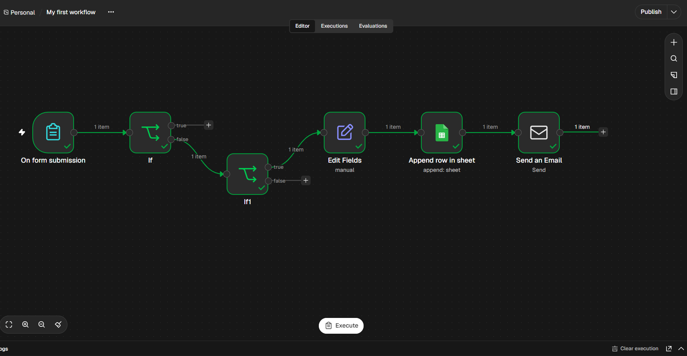

#  Restaurant Booking Automation

An automated restaurant booking workflow built using **n8n**, Google Sheets, and Gmail SMTP.

This project automates the initial process of collecting restaurant booking requests, validating customer information, saving booking details, and notifying the restaurant owner.

##  Business Problem

Restaurants often manage table reservations manually. This can take staff time and lead to missed information or forgotten notifications.

This automation helps reduce manual work by processing booking requests automatically.

##  Workflow Overview

The workflow follows these steps:

1. **Customer Form:** Collects the customer's name, phone number, booking date, and number of guests.
2. **Guest Count Validation:** Checks whether the guest count is between 1 and 20.
3. **Phone Number Validation:** Checks whether the phone number contains 7–15 digits.
4. **Format Booking Data:** Organizes the submitted information.
5. **Google Sheets:** Saves valid booking details automatically.
6. **Email Notification:** Sends an email notification to the restaurant owner.

##  Features

- Automated booking request collection
- Guest count validation
- Phone number validation
- Automatic Google Sheets data entry
- Email notifications
- Human review before reservation confirmation

##  Tools and Technologies

- n8n – Workflow automation
- Google Sheets – Booking data storage
- Gmail SMTP – Email notifications
- Docker – Local n8n setup
- JSON – Workflow data and configuration

## Testing and Results

The workflow was tested using actual form submissions.

- Valid booking details were successfully saved to Google Sheets.
- Email notifications were successfully delivered.
- Invalid phone number input was tested.
- Guest count validation was configured.

## Workflow Screenshot

## Project Files

| File | Description |
|---|---|
| `README.md` | Project documentation |
| `restaurant-booking-workflow-public.json` | Sanitized workflow template |
| `workflow-overview.png` | Workflow screenshot |

## Limitations

- The public JSON is a template and requires configuration before execution.
- Google Sheets and email credentials must be connected separately.
- The workflow does not automatically confirm reservations.
- Restaurant staff must check availability and confirm bookings manually.

##  What I Learned

Through this project, I practised:

- Building workflows using n8n
- Understanding triggers, conditions, and actions
- Validating customer input
- Connecting external services
- Working with Google Sheets and SMTP
- Testing an end-to-end automation
- Solving a practical business problem

## Future Improvements

- Add duplicate booking detection.
- Send automatic responses to customers.
- Add better error handling.
- Add booking status tracking.
- Introduce human approval steps.

---

**Project Type:** Personal Learning Project

**Part of:** AI Automation Learning Journey
